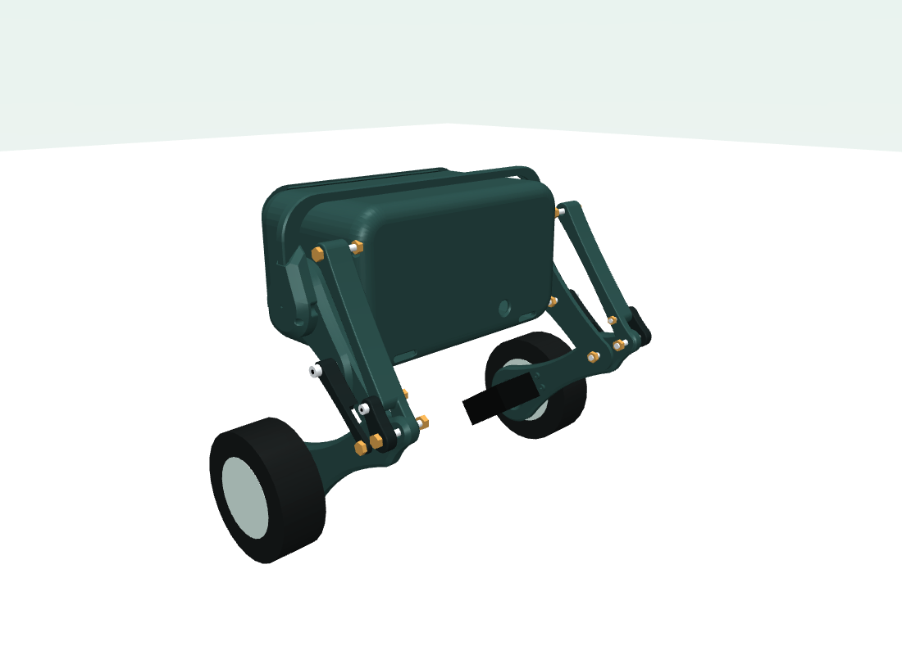
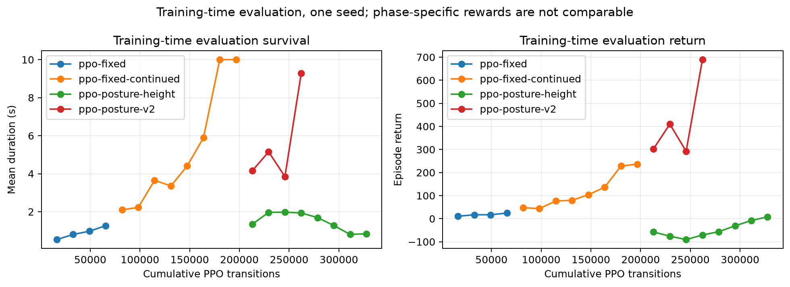

# TALOS

**An articulated two-wheel robot: ESP32 control, a CAD-based React dashboard, and offline MuJoCo experiments.**

Built by **Chanthul Kannangara** · [Project portfolio](https://chanthul.web.app/projects/talos) · [TALOS dashboard](https://talosone.web.app)

TALOS combines two continuous-rotation wheel servos, two encoder-controlled leg drives, an MPU6050 and an ESP32. This repository contains the current V17 commissioning firmware, the dashboard's original 13-component CAD assembly, direct USB pose telemetry, and the October 2026 engineering and reinforcement-learning studies.

**Status: commissioning and model identification are ongoing. Physical free balancing, calibrated height transitions, obstacle climbing and self-righting have not been validated.** The offline PPO candidate survived 22/24 ten-second simulation cases but passed **0/24** complete balance/posture accuracy tests. Its weights are retained for reproducibility and are not approved for the robot.



*CAD-derived simulation view. Fasteners and servo housings are schematic visuals; this is an uncalibrated rigid-body model.*

## October 2026 update

- **V17 firmware:** local MPU/wheel calculations target 500 Hz, leg feedback 100 Hz and servo PWM 50 Hz. Sensor health, stale-data checks, bounded leg tracking, explicit arming and a separate network task are implemented.
- **CAD dashboard:** Control, Posture, Camera and Settings workspaces, independent leg articulation, live IMU attitude, lazy-loaded WebGL, reduced-motion support and a fallback for unavailable 3D rendering. The original 13 structural meshes remain intact.
- **Direct USB feedback:** desktop Chrome/Edge Web Serial uses a leased 25 Hz, view-only pose stream. Rendering and linkage calculations run in the browser. Slider targets represent requested motion; the drawing uses encoder measurements. Actuator commands still use the existing control channel.
- **Mechanical assessment:** native-CAD measurements, linkage/load/power calculations, preliminary solid FEA, M4/M3 pivot annotations and executable MuJoCo models at three provisional initial hip heights.
- **Offline learning:** 393,216 PPO transitions across four stages/branches, saved policies and normalization, held-out traces, diagnostic plots and labelled simulation replays. Failed posture control remains visible in the results.

## Repository map

| Path | Contents |
| --- | --- |
| [`firmware/TALOS_V17_Stable_Control`](firmware/TALOS_V17_Stable_Control) | Current PlatformIO firmware and commissioning procedure |
| [`src`](src) | React dashboard, Firebase integration, USB telemetry and CAD pose views |
| [`public/models`](public/models) | Original assembly GLB and display-rig limitations |
| [`tools/cae`](tools/cae) | Offline calculations, FEA, MuJoCo, Gymnasium and PPO scripts |
| [`outputs/talos-cae-2026-10-11`](outputs/talos-cae-2026-10-11) | Dated assessment inputs, numerical results, STEP geometry and plots |
| [`outputs/talos-pivot-model-2026-10-12`](outputs/talos-pivot-model-2026-10-12) | Photo-informed pivot/servo model and geometric checks |
| [`outputs/talos-training-2026-10-12`](outputs/talos-training-2026-10-12) | Training study, final evaluations, weights and replay evidence |
| [`docs/PUBLICATION.md`](docs/PUBLICATION.md) | Included artifacts, omitted private files and reproduction limits |

`firmware/TALOS_Balance_Firebase` is an older positional-leg prototype with a different GPIO assignment. It is retained as history and must not be treated as the V17 wiring guide. The camera sketch is a separate optional device. Its local network configuration is excluded from Git.

## Dashboard setup

Use Node.js and pnpm. From this repository root:

```powershell
pnpm install --frozen-lockfile
Copy-Item .env.example .env.local
# Fill in your own Firebase web-app configuration in .env.local.
pnpm dev
```

Enable Firebase Authentication and configure the Realtime Database for your own account and device. Read [`database.rules.json`](database.rules.json), [`src/services/firebaseClient.js`](src/services/firebaseClient.js) and the firmware's network configuration before deployment. The supplied `.firebaserc` names the original development project; replace it with your own project/hosting target. A Firebase web configuration alone does not grant control access.

```powershell
pnpm build
node tools/validate-cad-rig.mjs
```

The development-only `/?preview-dashboard` route shows the workspace without a UI login. Database access rules still apply. `tools/pose-preview.html` supplies synthetic pose data for display checks and sends no robot commands. Web Serial requires a supported desktop browser and HTTPS or localhost; close other serial users first. Opening the ESP32 serial port may reset the device.

## Firmware and wiring

Use [`firmware/TALOS_V17_Stable_Control/README.md`](firmware/TALOS_V17_Stable_Control/README.md) for the current procedure. A compile-only check, from that folder:

```powershell
pio run
```

| Signal | ESP32 GPIO |
| --- | --- |
| MPU6050 + left AS5600 SDA / SCL | 21 / 22 |
| Right AS5600 SDA / SCL | 16 / 17 |
| Left / right leg servo | 26 / 25 |
| Left / right wheel servo | 27 / 33 |

AS5600s measure **leg position**. They provide no wheel-speed or odometry feedback. Servo power uses the regulated external supply and a common ground; the ESP32 does not supply motor current.

The 11 October commissioning record measured approximately 500 Hz calculation rate. A neutral, disarmed capture contained 200 USB packets at 25.02 Hz, no sequence gaps and a 40.01 ms median device interval. These are device/serial observations, not a measured end-to-end browser delay or mechanical accuracy claim. Both AS5600s still reported weak magnetic fields and both height endpoints were uncalibrated. The interlocks remain enabled.

## Offline simulation and training

Create a dedicated Python environment. Saved XML models and meshes load without SolidWorks; optional native CAD re-extraction requires the original SolidWorks files and installation.

```powershell
py -m venv .venv-mujoco
.\.venv-mujoco\Scripts\python.exe -m pip install -r tools\cae\requirements.txt
.\.venv-mujoco\Scripts\python.exe tools\cae\talos_env.py --output outputs\talos-pivot-model-2026-10-12
```

The command above runs the Gymnasium and diagnostic checks on an **uncontrolled/untuned** model; falling is an expected recorded failure. Rendering requires an OpenGL-capable driver. PPO evaluation also needs the optional training dependencies described in [`tools/cae/README.md`](tools/cae/README.md).

| Final evaluation | Survived 10 seconds | Full accuracy passes |
| --- | ---: | ---: |
| Diagnostic PD baseline | 0/24 | 0/24 |
| PPO fixed, continued | 19/24 | 0/24 |
| PPO posture + height | 0/24 | 0/24 |
| PPO posture v2 | 22/24 | 0/24 |

The full criterion includes posture tracking and speed accuracy. Surviving against soft joint limits is insufficient. One training seed and assumed mass, CoM, actuator lag and contact properties limit these results. The diagnostic PD baseline is not a faithful port of V17, so this comparison does not establish superiority over the physical controller. See the [study methodology and traces](outputs/talos-training-2026-10-12/README.md).



*Training returns use phase-specific rewards; compare the held-out criteria above rather than interpreting this curve as hardware performance.*

## Engineering evidence and remaining work

The structural CAD has 13 components; native assembly closure and the browser's display rig require separate interpretation. MuJoCo uses repaired planar linkage closure, approximate mass/inertia and simplified contacts. Its annotated pins, retaining clips and servo housings are zero-mass, non-colliding visuals. PLA/bolt friction, backlash, preload, wear, rail droop and thermal limits remain unidentified. The preliminary FEA is a screening calculation with assumed material properties.

Next commissioning work is to correct encoder magnetic health, verify supported leg tracking and endpoint references, measure assembled mass/CoM and actuator response, then test low-stance balancing with support and immediate power cutoff. No simulator policy, gain or provisional travel limit has been transferred to the ESP32 by this publication.

## License

Project source is provided under the [MIT license](LICENSE). Third-party libraries retain their own licenses. References and supplier specifications are identified in the assessment and study documentation.
